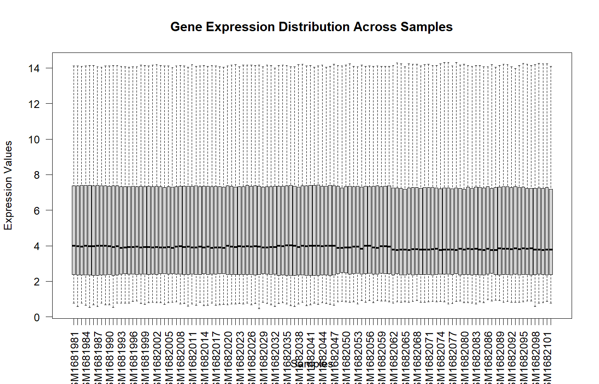
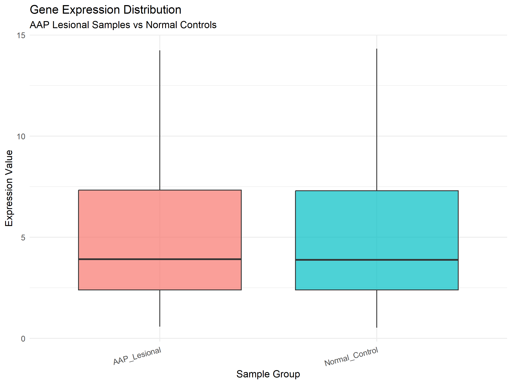
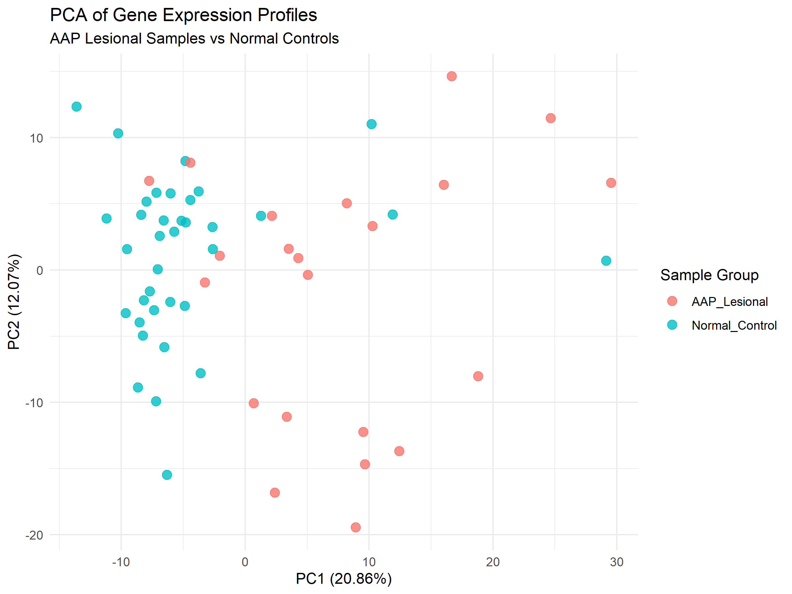
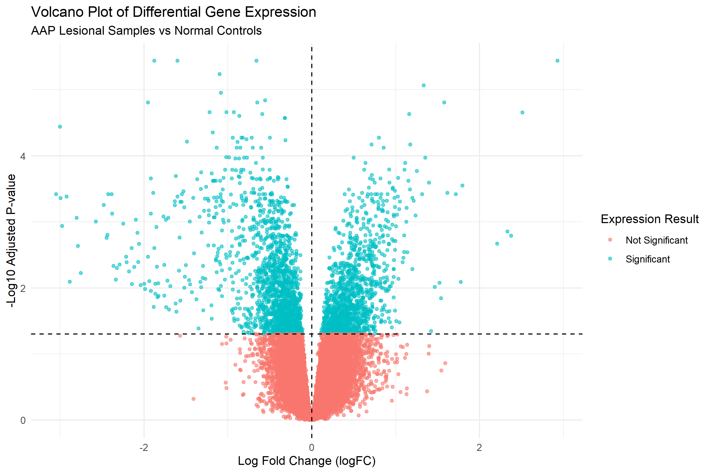

---
title: "Investigating the Relationship Between Immune Response and Hair Follicle Gene Expression in Alopecia Areata"
author: "Nishagee Malsha Dayarathna"
date: "`r Sys.Date()`"
output:
  html_document:
    toc: true
    toc_depth: 3
    number_sections: false
    theme: readable
    code_folding: hide
---

```{r setup, include=FALSE}
knitr::opts_chunk$set(
  echo = FALSE,
  warning = FALSE,
  message = FALSE,
  fig.align = "center",
  fig.width = 8,
  fig.height = 5,
  out.width = "90%"
)

library(knitr)
library(ggplot2)
```

# 1. Abstract

Alopecia Areata (AA) is an autoimmune condition associated with hair loss. This project investigates gene expression differences between Alopecia Areata affected scalp skin samples and normal controls using publicly available microarray data. The dataset GSE68801 was obtained from the National Center for Biotechnology Information Gene Expression Omnibus (NCBI GEO). The analysis was conducted using R and included data acquisition, quality control, exploratory data analysis, differential gene expression analysis and gene annotation. A focused comparison was performed between 22 AAP lesional samples and 36 normal control samples. The limma package was used to identify differentially expressed probes while accounting for microarray batch information. The analysis identified 2,984 significant probes using an adjusted p-value threshold of 0.05. The findings provide an overview of gene expression differences associated with Alopecia Areata.

# 2. Introduction

## 2.1 Background

Alopecia Areata is an autoimmune disorder that affects hair growth and can cause hair loss. It occurs when the immune system mistakenly attacks structures associated with hair follicles.

Gene expression analysis is a bioinformatics approach used to investigate biological changes associated with diseases. Gene expression refers to the process through which information from genes is used to produce functional products. Differences in gene expression between affected and normal samples can help identify genes associated with a particular biological condition.

In Alopecia Areata, investigating immune-response genes and hair follicle-related genes can provide useful information about molecular changes occurring in affected scalp skin.

## 2.2 Research Problem

Alopecia Areata is associated with changes in the biological environment of the scalp. Investigating gene expression differences between affected and normal skin samples can help identify genes associated with the disease.

## 2.3 Research Objective

The main objective of this project is to investigate the association between immune-response gene expression and hair follicle structural gene expression in Alopecia Areata.

## 2.4 Research Question

How does gene expression differ between Alopecia Areata lesional samples and normal control samples, particularly in relation to immune-response and hair follicle-related genes?

# 3. Dataset Description

## 3.1 Data Source

The dataset used in this project was obtained from the NCBI Gene Expression Omnibus (GEO).

- **Dataset accession:** GSE68801
- **Data source:** NCBI Gene Expression Omnibus
- **Platform:** Affymetrix Human Genome U133 Plus 2.0 Array
- **Organism:** Homo sapiens
- **Data type:** Gene expression microarray data

The dataset contains gene expression measurements obtained from scalp skin biopsy samples.

Dataset link: https://www.ncbi.nlm.nih.gov/geo/query/acc.cgi?acc=GSE68801

## 3.2 Dataset Information

The imported expression matrix contains 54,675 probes and 122 samples.

The original dataset contains several disease and sample categories:

| Sample group | Number of samples |
|---|---:|
| AAP | 42 |
| AAP.T | 12 |
| AT | 9 |
| AU | 23 |
| Normal | 36 |
| **Total** | **122** |

For the primary analysis, 22 AAP lesional samples and 36 normal control samples were selected. The remaining samples were excluded from this focused comparison.

Therefore, the primary analysis contains 58 samples.

| Research group | Number of samples |
|---|---:|
| AAP Lesional | 22 |
| Normal Control | 36 |
| **Total** | **58** |

## 3.3 Data Preprocessing

The downloaded GEO series matrix contained processed GCRMA-normalised expression values. Therefore, another log transformation or normalisation step was not applied.

The expression matrix and sample metadata were extracted and saved for further analysis.

# 4. Methods

The analysis was conducted using R. The workflow included data acquisition, quality control, exploratory data analysis, differential gene expression analysis and gene annotation.

## 4.1 Data Acquisition and Import

The GEOquery package was used to obtain the GSE68801 dataset from NCBI GEO.

The expression matrix and sample metadata were extracted from the imported dataset. The extracted data were saved locally for use in the remaining analysis stages.

## 4.2 Quality Control

Quality control was performed to examine the structure and reliability of the imported expression data.

The following checks were conducted:

- Missing expression values.
- Infinite expression values.
- Duplicate probe identifiers.
- Expression value distributions.
- Sample-level mean and standard deviation.

A boxplot was generated to compare expression distributions across samples.

The dataset contained no missing expression values, no infinite values and no duplicate probe identifiers. The sample expression distributions showed broadly similar medians and ranges.

The overall expression summary is presented below.

| Measurement | Value |
|---|---:|
| Minimum expression | 0.452 |
| First quartile | 2.387 |
| Median | 3.887 |
| Mean | 4.975 |
| Third quartile | 7.319 |
| Maximum expression | 14.318 |

### Figure 1. Gene Expression Quality Control

The following boxplot presents the distribution of gene expression values across all samples.

```{r figure-1, fig.cap="Gene expression distribution across all samples."}

```

The sample expression distributions showed broadly similar medians and ranges. No obvious major outlier or distribution difference was observed from the boxplot.

## 4.3 Exploratory Data Analysis

Exploratory Data Analysis (EDA) was performed to understand the dataset and identify general expression patterns.

The following activities were completed:

- Examining disease and sample group distributions.
- Summarising sample metadata.
- Comparing gene expression distributions between research groups.
- Performing Principal Component Analysis (PCA).

### Figure 2. Group Expression Distribution

The following figure compares the expression distributions of the selected research groups.

```{r figure-2, fig.cap="Gene expression distribution across the selected research groups."}

```

The figure provides an overview of expression distributions between AAP lesional and normal control samples.

### Figure 3. Principal Component Analysis

Principal Component Analysis (PCA) was performed using the 500 most variable probes.

PCA is a dimensionality reduction method used to summarise variation in high-dimensional data.

The first principal component explained approximately 20.86% of the variance, while the second explained approximately 12.07%.

Together, these two components explained approximately 32.93% of the total variance.

```{r figure-3, fig.cap="Principal Component Analysis using the 500 most variable probes."}

```

The PCA plot showed some separation between AAP lesional and normal control samples, although overlap was also observed.

This analysis provides an exploratory view of sample variation and was not used as a statistical test of differential expression.

## 4.4 Differential Gene Expression Analysis

Differential gene expression analysis was performed to identify probes with different expression levels between AAP lesional samples and normal controls.

The limma package was used for this analysis.

A linear model was created using research group and microarray batch information. Microarray batch was included in the model to account for possible technical differences between experimental batches.

The empirical Bayes method was applied using the `eBayes()` function.

Normal controls were used as the reference group.

The Benjamini-Hochberg method was used to adjust p-values for multiple testing.

A probe was considered statistically significant when:

**Adjusted p-value &lt; 0.05**

Positive log fold change values indicate higher expression in AAP lesional samples compared with normal controls.

Negative log fold change values indicate lower expression in AAP lesional samples compared with normal controls.

### Differential Expression Summary

| Measurement | Result |
|---|---:|
| Total probes analysed | 54,675 |
| AAP lesional samples | 22 |
| Normal control samples | 36 |
| Total selected samples | 58 |
| Significant probes | 2,984 |
| Adjusted p-value threshold | 0.05 |

## 4.5 Gene Annotation

Gene annotation was performed to make the differential expression results easier to interpret.

The `hgu133plus2.db` annotation package and `AnnotationDbi` package were used to map probe identifiers to gene information.

The annotation included:

- Gene symbols.
- Gene names.
- Entrez Gene identifiers.

The annotation process identified gene symbols for 44,647 probes. Among the significant results, 2,234 unique gene symbols were identified.

Some probes can map to more than one annotation. Therefore, the number of annotation rows may differ from the number of significant probes.

## 4.6 Volcano Plot Visualisation

A volcano plot was created to visualise the differential expression results.

The x-axis represents log fold change (logFC), while the y-axis represents the negative logarithm of the adjusted p-value.

Positive logFC values indicate higher expression in AAP lesional samples compared with normal controls. Negative logFC values indicate lower expression.

The plot uses an adjusted p-value threshold of 0.05 to distinguish significant and non-significant probes.

### Figure 4. Volcano Plot

```{r figure-4, fig.cap="Volcano plot showing differential gene expression between AAP lesional samples and normal controls."}

```

The volcano plot provides a visual summary of the magnitude and statistical significance of the expression differences.

# 5. Results

## 5.1 Quality Control Results

The quality control analysis confirmed that the expression matrix contained no missing values, infinite values or duplicate probe identifiers.

The expression values ranged from approximately 0.452 to 14.318, with a mean expression value of approximately 4.975.

The sample-level distributions showed broadly similar patterns, with no obvious major differences in the overall expression distributions.

## 5.2 Exploratory Analysis Results

The exploratory analysis showed the distribution of samples across disease groups and skin types.

The PCA visualisation showed some separation between AAP lesional and normal control samples, although overlap was also observed.

The first two principal components explained approximately 32.93% of the total variance.

These results provide an exploratory understanding of the variation within the selected samples. PCA was not used as a statistical test of differential expression.

## 5.3 Differential Expression Results

The differential expression analysis examined 54,675 probes.

A total of 2,984 probes were identified as statistically significant using an adjusted p-value threshold of 0.05.

The results were saved in:

- `results/tables/differential_expression_results.csv`
- `results/tables/significant_differential_expression.csv`

Positive logFC values represent higher expression in AAP lesional samples, while negative logFC values represent lower expression compared with normal controls.

## 5.4 Gene Annotation Results

Gene annotation provided biological identifiers for the differential expression results.

A total of 44,647 probes had associated gene symbols. The significant results contained 2,234 unique gene symbols.

The annotated results were saved in:

- `results/tables/annotated_differential_expression.csv`
- `results/tables/significant_annotated_genes.csv`

## 5.5 Volcano Plot Results

The volcano plot presents the distribution of significant and non-significant probes.

The visualisation shows significant probes on both the positive and negative sides of the logFC axis. This indicates that some probes had higher expression and others had lower expression in AAP lesional samples compared with normal controls.

The volcano plot provides a visual summary of the differential expression analysis.

# 6. Discussion

The analysis identified gene expression differences between AAP lesional scalp skin samples and normal control samples.

The identification of 2,984 significant probes indicates that many measured probes showed statistically significant expression differences after adjustment for multiple testing.

The inclusion of microarray batch information in the limma model helped account for technical variation between batches during the comparison.

Gene annotation made the results easier to interpret by connecting probe identifiers with gene symbols and gene names.

The PCA and volcano plot provided visual summaries of the expression data and differential expression findings.

However, these results should be interpreted carefully. The dataset contains whole scalp skin biopsy samples rather than isolated hair follicle cells. Therefore, observed expression differences may reflect changes in different cell types within the skin.

Furthermore, differential expression between the two sample groups does not by itself demonstrate a direct correlation or causal relationship between immune-response genes and hair follicle structural genes.

# 7. Limitations

The project has several limitations:

1. The analysis uses one publicly available dataset.
2. The samples represent scalp skin biopsies rather than isolated hair follicle cells.
3. The primary comparison focuses only on AAP lesional samples and normal controls.
4. The analysis identifies expression differences but does not establish causal relationships.
5. The results depend on the characteristics and quality of the original microarray dataset.
6. A direct statistical association between selected immune-response genes and hair follicle structural genes has not been established in the current workflow.

# 8. Conclusion and Future Work

This project demonstrates a bioinformatics workflow for investigating gene expression differences associated with Alopecia Areata using R.

The GSE68801 dataset was imported, checked for quality, explored and analysed using differential gene expression methods. The limma analysis identified 2,984 significant probes, and gene annotation provided biological information for interpreting the results.

The volcano plot and other visualisations helped present the findings.

Future work could include a focused investigation of selected immune-response and hair follicle structural genes and a direct analysis of their expression relationships.

# 9. Reproducibility

## 9.1 Software and Packages

The project was developed using R.

The main packages used include:

- GEOquery
- limma
- ggplot2
- AnnotationDbi
- hgu133plus2.db
- dplyr

## 9.2 Project Structure

```text
Alopecia_Areata_Bioinformatics/
|
|-- README.md
|-- .gitignore
|
|-- data/
|   |-- raw/
|   |-- processed/
|
|-- code/
|   |-- 01_data_import.R
|   |-- 02_quality_control.R
|   |-- 03_exploratory_analysis.R
|   |-- 04_differential_expression.R
|   |-- 05_gene_annotation.R
|   |-- 06_volcano_plot.R
|
|-- results/
|   |-- figures/
|   |-- tables/
|
|-- report/
    |-- Alopecia_Areata_Report.Rmd
    |-- Alopecia_Areata_Report.html
```

## 9.3 Running the Analysis

Clone the GitHub repository:

```bash
git clone https://github.com/nishageedayarathna/Alopecia-Areata-Gene-Expression-Analysis.git
```

Open the project folder in RStudio.

Run the R scripts in the following order:

1. `01_data_import.R`
2. `02_quality_control.R`
3. `03_exploratory_analysis.R`
4. `04_differential_expression.R`
5. `05_gene_annotation.R`
6. `06_volcano_plot.R`

Install the required R packages before running the scripts if they are not already available.

The data import script downloads the GEO series matrix when the required raw file is not already available. Generated intermediate files may need to be recreated by running the scripts in order.

# 10. References

1. National Center for Biotechnology Information (NCBI). Gene Expression Omnibus (GEO). GSE68801. https://www.ncbi.nlm.nih.gov/geo/query/acc.cgi?acc=GSE68801

2. Ritchie, M. E., et al. (2015). limma powers differential expression analyses for RNA-sequencing and microarray studies. *Nucleic Acids Research*, 43(7), e47. https://doi.org/10.1093/nar/gkv007

3. Davis, S., and Meltzer, P. S. (2007). GEOquery: a bridge between the Gene Expression Omnibus (GEO) and BioConductor. *Bioinformatics*, 23(14), 1846–1847. https://doi.org/10.1093/bioinformatics/btm254

4. R Core Team. R: A language and environment for statistical computing. https://www.r-project.org/
